# Project Figures, Architecture Diagrams & Screenshots Gallery
## Weed vs Crop Discrimination Using Deep Learning & Computer Vision

> **Purpose:** Dedicated visual gallery and screenshot capture sheet for Google Docs / Academic Report documentation.  
> **How to use:** Open this file in your IDE's Markdown Preview (or browser) to capture screenshots directly, or use the direct file links below to access the exact generated high-resolution PNG/JPG assets.

---

## Table of Figures

1. [Figure 1: Complete End-to-End System Architecture Diagram](#figure-1-complete-end-to-end-system-architecture-diagram)
2. [Figure 2: Qualitative Detection Outputs (Field Predictions)](#figure-2-qualitative-detection-outputs-field-predictions)
3. [Figure 3: Interactive Streamlit Web Application Dashboard](#figure-3-interactive-streamlit-web-application-dashboard)
4. [Figure 4: Precision-Recall (PR) Curves & Confidence Sweep](#figure-4-precision-recall-pr-curves--confidence-sweep)
5. [Figure 5: Object Detection Confusion Matrix](#figure-5-object-detection-confusion-matrix)
6. [Figure 6: Exploratory Data Analysis (EDA) Scale & Distribution Plots](#figure-6-exploratory-data-analysis-eda-scale--distribution-plots)
7. [Figure 7: PyTest 12/12 Automated Verification Suite](#figure-7-pytest-1212-automated-verification-suite)

---

## Figure 1: Complete End-to-End System Architecture Diagram

> **Caption for Doc:** *Figure 1: End-to-end deep learning pipeline for weed vs. crop discrimination. The architecture ingests raw $1920 \times 1088$ field imagery, enforces zero session leakage through session-grouped partitioning, extracts multi-scale representations via MobileNetV3-Large FPN ($P_2$–$P_5$), proposes candidate regions via RPN, and outputs classified bounding boxes with confidence scores into an interactive Streamlit dashboard.*

### Visual Architecture Flowchart (Mermaid)

```mermaid
flowchart TD
    %% Styling and Theme
    classDef inputNode fill:#1e293b,stroke:#38bdf8,stroke-width:2px,color:#f8fafc;
    classDef splitNode fill:#312e81,stroke:#818cf8,stroke-width:2px,color:#f8fafc;
    classDef backboneNode fill:#064e3b,stroke:#34d399,stroke-width:2px,color:#f8fafc;
    classDef fpnNode fill:#134e4a,stroke:#2dd4bf,stroke-width:2px,color:#f8fafc;
    classDef headNode fill:#701a75,stroke:#f472b6,stroke-width:2px,color:#f8fafc;
    classDef outputNode fill:#7c2d12,stroke:#fb923c,stroke-width:2px,color:#f8fafc;
    classDef appNode fill:#0f172a,stroke:#38bdf8,stroke-width:3px,color:#38bdf8;

    subgraph S1["STAGE 1: RAW INGESTION & ZERO-LEAKAGE SPLITTING"]
        RAW["High-Resolution Field Photographs<br/>1920 × 1088 RGB (.jpg)<br/>2,003 Images across 194 Sessions"]:::inputNode
        SPLIT["Session-Grouped Stratified Split<br/>Strict Zero-Leakage (prefix-session)<br/>Train: 135 sess (1,381 imgs)<br/>Val: 29 sess (338 imgs)<br/>Test: 30 sess (284 imgs)"]:::splitNode
        RAW --> SPLIT
    end

    subgraph S2["STAGE 2: PREPROCESSING & FEATURE EXTRACTION"]
        NORM["Aspect-Preserving Resize & Normalization<br/>Scale: min=640px, max=1024px<br/>ImageNet RGB Mean/Std Normalization"]:::splitNode
        SPLIT --> NORM
        BACKBONE["MobileNetV3-Large Backbone<br/>Pretrained on ImageNet / COCO<br/>Depthwise Separable Convolutions<br/>Squeeze-and-Excitation + Hard-Swish"]:::backboneNode
        NORM --> BACKBONE
        FPN["Feature Pyramid Network (FPN)<br/>Multi-Scale Feature Hierarchy<br/>Levels P2 (1/4), P3 (1/8), P4 (1/16), P5 (1/32)<br/>Essential for Small Weeds (<32px)"]:::fpnNode
        BACKBONE --> FPN
    end

    subgraph S3["STAGE 3: TWO-STAGE DETECTION HEAD"]
        RPN["Region Proposal Network (RPN)<br/>Anchor Generator: 5 Scales × 3 Aspect Ratios<br/>(32, 64, 128, 256, 512 px) × (0.5, 1.0, 2.0)<br/>Proposes ~1,000 RoIs"]:::headNode
        FPN --> RPN
        ROIALIGN["RoIAlign Layer<br/>Extracts 7 × 7 Feature Maps per Proposal<br/>Bilinear Interpolation (No Quantization Error)"]:::headNode
        FPN --> ROIALIGN
        RPN --> ROIALIGN
        BOXHEAD["Two-Layer MLP Detection Head<br/>Dense(1024) + ReLU + Dropout(0.2)<br/>Dense(1024) + ReLU"]:::headNode
        ROIALIGN --> BOXHEAD
        CLS["Classification Branch<br/>Linear -> 3 Logits<br/>(0: Bg, 1: Crop, 2: Weed)"]:::outputNode
        REG["Bounding Box Regressor<br/>Linear -> 3 × 4 Deltas<br/>(dx, dy, dw, dh)"]:::outputNode
        BOXHEAD --> CLS
        BOXHEAD --> REG
    end

    subgraph S4["STAGE 4: POST-PROCESSING & FIELD DEPLOYMENT"]
        NMS["Non-Maximum Suppression (NMS)<br/>IoU Threshold = 0.50<br/>Score Threshold = 0.40 - 0.50"]:::outputNode
        CLS & REG --> NMS
        
        CLI["CLI Inference Engine<br/>src/inference/predict.py<br/>Automated JSON Summaries<br/>Batch Field Processing"]:::appNode
        STREAMLIT["Interactive Streamlit Web App<br/>app/streamlit_app.py<br/>Side-by-Side Original vs Prediction<br/>Confidence Slider & KPI Metrics<br/>Weed Pressure Index Calculator"]:::appNode
        
        NMS --> CLI
        NMS --> STREAMLIT
    end
```



---

### Alternative High-Contrast ASCII Block Architecture

```text
+-------------------------------------------------------------------------------------------------------+
|                                    1. RAW INGESTION & SPLITTING                                       |
|  [ 2,003 Field Photos (1920x1088) ] ---> [ Session-Grouped Split: 135 Train / 29 Val / 30 Test ]     |
|                                         (STRICT ZERO-LEAKAGE: 0.0% Session Overlap)                   |
+-------------------------------------------------------------------------------------------------------+
                                                   |
                                                   v
+-------------------------------------------------------------------------------------------------------+
|                                  2. PREPROCESSING & MULTI-SCALE FPN                                   |
|  [ Resized (640x1024) ] ---> [ MobileNetV3-Large Backbone ] ---> [ Feature Pyramid Network (P2-P5) ]   |
+-------------------------------------------------------------------------------------------------------+
                                                   |
                                                   v
+-------------------------------------------------------------------------------------------------------+
|                                   3. TWO-STAGE DETECTION ENGINE                                       |
|  [ Feature Pyramid (P2-P5) ] ---> [ Region Proposal Network (RPN) ] ---> [ RoIAlign (7x7 Pooling) ]   |
|                                                                                    |                  |
|                                                                                    v                  |
|  [ Bounding Box Regression Head (Smooth L1) ] <------------------------ [ Two-Layer MLP Head ]        |
|  [ 3-Class Classifier (0:Bg, 1:Crop, 2:Weed) (Cross-Entropy) ] <------------------'                   |
+-------------------------------------------------------------------------------------------------------+
                                                   |
                                                   v
+-------------------------------------------------------------------------------------------------------+
|                                     4. INFERENCE & USER INTERFACES                                    |
|                                  [ Non-Maximum Suppression (NMS >= 0.50) ]                            |
|                                          /                       \                                    |
|                                         v                         v                                   |
|               [ CLI Inference Engine (predict.py) ]    [ Interactive Streamlit App ]                  |
|               * JSON Detection Summaries               * Side-by-Side Color Overlays                  |
|               * Automated Batch Pipeline               * Dynamic Confidence Slider                    |
|               * Weed Pressure Index Metric             * Real-time KPI Metric Cards                   |
+-------------------------------------------------------------------------------------------------------+
```

---

## Figure 2: Qualitative Detection Outputs (Field Predictions)

> **Caption for Doc:** *Figure 2: Qualitative detection results on real agricultural field images. Bounding boxes highlight detected commercial crops in green and invasive weeds in red, with corresponding class probabilities displayed above each box.*

### High-Resolution Annotated Prediction Files in Workspace

You can directly view and copy these annotated output images from your local `outputs/predictions/` folder:

* **Prediction Sample 1:** [`outputs/predictions/ave-0040-0001_annotated.jpg`](file:///c:/Github/WEED_VS_CROP_DL_PROJECT_SPECIFICATION/outputs/predictions/ave-0040-0001_annotated.jpg)  
  * *Metrics:* 1 Crop detected (Score: **86.9%**), 0 Weeds, High precision centering.
* **Prediction Sample 2:** [`outputs/predictions/ave-0040-0002_annotated.jpg`](file:///c:/Github/WEED_VS_CROP_DL_PROJECT_SPECIFICATION/outputs/predictions/ave-0040-0002_annotated.jpg)  
  * *Metrics:* 4 Crops detected (Scores: **91.2%**, **79.5%**, **72.6%**, **54.0%**), 0 Weeds.
* **Prediction Sample 3:** [`outputs/predictions/ave-0040-0003_annotated.jpg`](file:///c:/Github/WEED_VS_CROP_DL_PROJECT_SPECIFICATION/outputs/predictions/ave-0040-0003_annotated.jpg)  
  * *Metrics:* Multiple crop plant detections under bright diffuse field sunlight.
* **Prediction Sample 4:** [`outputs/predictions/ave-0040-0005_annotated.jpg`](file:///c:/Github/WEED_VS_CROP_DL_PROJECT_SPECIFICATION/outputs/predictions/ave-0040-0005_annotated.jpg)  
  * *Metrics:* Dense multi-plant row localization.
* **Non-Dataset Real-World Field Test:** [`outputs/predictions/non_dataset_test_sample_annotated.jpg`](file:///c:/Github/WEED_VS_CROP_DL_PROJECT_SPECIFICATION/outputs/predictions/non_dataset_test_sample_annotated.jpg)  
  * *Metrics:* Generalization validation on arbitrary external field photo (3 crops detected at **95.8%**, **95.0%**, **91.9%**).
* **Complete 12-Panel Ground Truth Grid:** [`outputs/plots/samples.png`](file:///c:/Github/WEED_VS_CROP_DL_PROJECT_SPECIFICATION/outputs/plots/samples.png)  
  * *Metrics:* 3×4 high-resolution overview of diverse lighting, weed pressures, and crop growth stages.

### Bounding Box Visual Legend

| Color | Label Name | Class ID | Bounding Box Rendering | Meaning in Field Management |
|:---:|:---:|:---:|:---:|---|
| <span style="color:#22c55e; font-weight:bold;">GREEN</span> | **`crop`** | `1` | `#00FF00` Box + Score | Commercial crop canopy (Protect from herbicide) |
| <span style="color:#ef4444; font-weight:bold;">RED</span> | **`weed`** | `2` | `#FF0000` Box + Score | Competing weed foliage (Target for precision spot-spraying) |

---

## Figure 3: Interactive Streamlit Web Application Dashboard

> **Caption for Doc:** *Figure 3: Interactive Streamlit dashboard (`app/streamlit_app.py`). The interface enables agricultural agronomists to upload raw field photographs, adjust the confidence score threshold (0.10–0.95), select hardware compute (CPU vs. NVIDIA CUDA), inspect side-by-side original and annotated detections, review summary KPI cards (Crop Count, Weed Count, Total Plants, Weed Pressure Index), and examine a tabular dataframe of bounding box coordinates.*

### How to Launch the Streamlit App for Your Live Screenshot:

Open your PowerShell terminal and run:
```powershell
.venv\Scripts\streamlit.exe run app/streamlit_app.py
```
*(The browser will automatically open at `http://localhost:8501`)*

### Quick Steps to Take the Screenshot:
1. In the sidebar, leave the model checkpoint as `models/best.pt`.
2. Drag and drop any image from `sample_images/` (e.g., `sample_images/ave-0000-0001.jpg` or `sample_images/ave-0035-0001.jpg`).
3. Set the **Confidence Score Threshold** slider to **0.40** or **0.50**.
4. Capture a clean browser screenshot of the resulting page!

### Visual Dashboard Mockup (Layout Preview)

```text
+-------------------------------------------------------------------------------------------------------------------+
|  Field-Image Weed vs Crop AI Detector                                                      [ ● CUDA ACCELERATED ]|
|  Detects, localizes, and discriminates crops and weeds using Faster R-CNN MobileNetV3-Large FPN                    |
+-------------------------------------------------------------------------------------------------------------------+
|  [ SIDEBAR SETTINGS ]      |                                                                                      |
|  Checkpoint: models/best.pt|  +-----------------------------------+  +-----------------------------------+        |
|  Threshold: [===|===] 0.50 |  |       ORIGINAL FIELD IMAGE        |  |       AI DETECTION OVERLAY        |        |
|  Hardware: [ CUDA (RTX) v ]|  |  [ Real 1920x1088 Field Photograph]  |  |  [ Green: Crop Boxes (Conf: 88%) ]|        |
|                            |  |                                   |  |  [ Red: Weed Boxes (Conf: 65%)   ] |       |
|  Uploaded: ave-0000-0001   |  +-----------------------------------+  +-----------------------------------+        |
|                            |                                                                                      |
|                            |  +------------------+  +------------------+  +------------------+  +---------------+ |
|                            |  |   CROP COUNT     |  |   WEED COUNT     |  |   TOTAL PLANTS   |  | WEED PRESSURE | |
|                            |  |       5          |  |       14         |  |        19        |  |    73.7%      | |
|                            |  +------------------+  +------------------+  +------------------+  +---------------+ |
|                            |                                                                                      |
|                            |  ### Detected Plant Instances                                                        |
|                            |  | Index | Class | Confidence | Box [X1, Y1, X2, Y2]                                |
|                            |  |-------|-------|------------|-----------------------------------------------------|
|                            |  | 1     | crop  | 88.4%      | [412.0, 280.5, 530.2, 395.1]                        |
|                            |  | 2     | weed  | 74.2%      | [1120.5, 610.0, 1185.3, 680.4]                      |
|                            |  | 3     | weed  | 65.8%      | [780.1, 450.2, 835.9, 510.6]                        |
+-------------------------------------------------------------------------------------------------------------------+
```

---

## Figure 4: Precision-Recall (PR) Curves & Confidence Sweep

> **Caption for Doc:** *Figure 4: Precision-Recall (PR) trajectories evaluated on the 284 held-out test field images at IoU $\ge 0.50$. The commercial crop class achieves an Average Precision (AP) of 0.3247, while invasive weeds achieve 0.0667 due to small scale ($<32\text{ px}$) and cotyledon morphology ambiguity.*

### Direct Image File:
* **PR Curves Plot:** [`outputs/plots/pr_curves.png`](file:///c:/Github/WEED_VS_CROP_DL_PROJECT_SPECIFICATION/outputs/plots/pr_curves.png)

### Accompanying Empirical Data Table:

| Confidence Threshold ($\tau$) | Weed Precision ($P$) | Weed Recall ($R$) | Weed F1-Score ($F_1$) | Operating Mode & Trade-off |
|:---:|:---:|:---:|:---:|---|
| **0.10** | 13.56% | **35.69%** | 0.1965 | Maximum Weed Eradication |
| **0.20** | 19.11% | 32.71% | 0.2413 | Aggressive Field Cleanup |
| **0.30** | 26.09% | 29.54% | 0.2771 | Balanced Spot-Spraying |
| **0.40** | 35.84% | 24.90% | **0.2939** | **Peak F1 Operational Point** |
| **0.50** | 47.09% | 20.86% | 0.2891 | Standard VOC Benchmark |
| **0.60** | 59.09% | 16.49% | 0.2579 | Herbicide Conservation Mode |
| **0.70** | 67.17% | 12.25% | 0.2072 | Crop Injury Prevention Mode |
| **0.80** | 71.76% | 7.45% | 0.1351 | Ultra-Conservative Spot Treatment |
| **0.90** | **78.65%** | 2.78% | 0.0536 | High-Confidence Foliage Clusters |

---

## Figure 5: Object Detection Confusion Matrix

> **Caption for Doc:** *Figure 5: Detection confusion matrix on 284 held-out test field images at $\text{IoU} \ge 0.50$ and score threshold $\tau = 0.50$. Across 2,792 physical plants, the model correctly identified 339 crops and 526 weeds, while missing 1,934 tiny weed instances and confusing 36 crops as weeds and 62 weeds as crops.*

### Direct Image Files:
* **Full Object Detection Confusion Matrix:** [`outputs/plots/detection_confusion_matrix.png`](file:///c:/Github/WEED_VS_CROP_DL_PROJECT_SPECIFICATION/outputs/plots/detection_confusion_matrix.png)
* **Patch Baseline Upper-Bound Confusion Matrix:** [`outputs/plots/baseline_confusion_matrix.png`](file:///c:/Github/WEED_VS_CROP_DL_PROJECT_SPECIFICATION/outputs/plots/baseline_confusion_matrix.png)

### Numerical Matrix Representation:

```text
                                PREDICTED CLASS
                    +-------------------+-------------------+-------------------+
                    |       Crop        |       Weed        |  Missed (Backgnd) |
+-------------------+-------------------+-------------------+-------------------+
| Ground Truth Crop |    339 (60.1%)    |     36 (6.4%)     |    189 (33.5%)    |
+-------------------+-------------------+-------------------+-------------------+
| Ground Truth Weed |     62 (2.5%)     |    526 (20.9%)    |  1,934 (76.7%)    |
+-------------------+-------------------+-------------------+-------------------+
| False Alarm (Soil)|    132 instances  |    555 instances  |         -         |
+-------------------+-------------------+-------------------+-------------------+
```

---

## Figure 6: Exploratory Data Analysis (EDA) Scale & Distribution Plots

> **Caption for Doc:** *Figure 6: Exploratory data analysis of the CropAndWeed dataset (`CropOrWeed2` variant). (Left) Bounding box scale breakdown illustrating that 68.0% of all annotated plants are small or tiny ($<96\text{ px}$), establishing the requirement for Feature Pyramid Networks. (Right) Class distribution across 19,785 instances demonstrating 74.1% weed prevalence reflecting real-world agricultural weed pressure.*

### Direct Image Files:
* **Bounding Box Scale Histogram:** [`outputs/plots/box_size_hist.png`](file:///c:/Github/WEED_VS_CROP_DL_PROJECT_SPECIFICATION/outputs/plots/box_size_hist.png)
* **Class Distribution Bar Chart:** [`outputs/plots/class_distribution.png`](file:///c:/Github/WEED_VS_CROP_DL_PROJECT_SPECIFICATION/outputs/plots/class_distribution.png)
* **Training & Validation Learning Curves:** [`outputs/plots/learning_curves.png`](file:///c:/Github/WEED_VS_CROP_DL_PROJECT_SPECIFICATION/outputs/plots/learning_curves.png)

### Numerical Summary:

* **Total Images:** 2,003 native high-resolution field photographs ($1920 \times 1088$)
* **Total Plant Instances:** 19,785
  * **Crop Instances:** 5,128 (**25.9%**)
  * **Weed Instances:** 14,657 (**74.1%**)
* **Object Scale Distribution:**
  * **Tiny (< 32 px):** 4,314 boxes (**21.8%**)
  * **Small (32 – 96 px):** 9,150 boxes (**46.2%**)  *(Combined Tiny+Small = 68.0%)*
  * **Medium (96 – 256 px):** 4,702 boxes (**23.8%**)
  * **Large (> 256 px):** 1,619 boxes (**8.2%**)

---

## Figure 7: PyTest 12/12 Automated Verification Suite

> **Caption for Doc:** *Figure 7: Automated unit and integration test suite execution. All 12 test assertions pass with 100% success, verifying label integrity, zero session leakage, PyTorch dataset collation, Faster R-CNN forward passes (train/eval), checkpoint serialization, and error handling.*

### Simulated Dark-Mode Terminal Output:

```bash
============================= test session starts =============================
platform win32 -- Python 3.11.9, pytest-8.3.4, pluggy-1.5.0
rootdir: C:\Github\WEED_VS_CROP_DL_PROJECT_SPECIFICATION
configfile: pytest.ini
collected 12 items

tests/test_splits.py::TestSplits::test_splits_zero_leakage                   PASSED [  8%]
tests/test_splits.py::TestSplits::test_verify_splits_integrity_catches_leakage PASSED [ 16%]
tests/test_labels.py::TestLabels::test_class_mapping                        PASSED [ 25%]
tests/test_labels.py::TestLabels::test_parse_croporweed2_labels             PASSED [ 33%]
tests/test_dataset.py::TestDataset::test_dataset_length_and_getitem          PASSED [ 41%]
tests/test_dataset.py::TestDataset::test_collate_fn                         PASSED [ 50%]
tests/test_model.py::TestDetector::test_detector_build                      PASSED [ 58%]
tests/test_model.py::TestDetector::test_detector_forward_train              PASSED [ 66%]
tests/test_model.py::TestDetector::test_detector_forward_eval               PASSED [ 75%]
tests/test_checkpoint.py::TestCheckpoint::test_save_and_load_checkpoint     PASSED [ 83%]
tests/test_inference.py::TestInference::test_predict_image_and_summarize    PASSED [ 91%]
tests/test_inference.py::TestInference::test_invalid_image_handling         PASSED [100%]

============================== 12 passed in 14.82s ==============================
```
